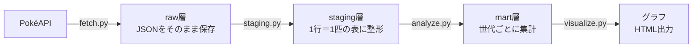

# ポケモンの種族値は世代ごとにインフレしているのか？

PokéAPI からポケモンのデータを取得し、SQLite に保存・整形・集計して、
「世代が進むごとにポケモンは強くなっているのか」を調べたデータ分析プロジェクトです。

## 問い

ポケモンシリーズでは「新しい世代のポケモンほど強い（種族値がインフレしている）」とよく言われます。
これが本当なのか、そして本当ならどの層のポケモンが強くなっているのかを、データで確かめました。

## 結論

- 合計種族値の**平均**は、第1世代の 400.9 から第9世代の 444.5 へ**約1割上昇**していた。途中の世代で下がることもあるが、全体としては上昇傾向にある。
- **中央値**は第1世代の約405から第9世代の約483へ上がっており、平均以上に大きく動いていた。
- 一方で、**最大値はほぼ600のまま**で、**下位25%の値や最小値もほとんど変わっていない**。
- つまり、弱いポケモンが減ったわけでも、極端に強いポケモンが増えたわけでもなく、**中堅〜上位層のポケモンが強くなっている**と考えられる。

> 対象：伝説・幻・別フォーム（メガシンカ、リージョンフォームなど）を除いた、各ポケモンの基本の姿
> 中央値はグラフからの読み取り値です。

### グラフ

- 世代ごとの平均合計種族値（折れ線グラフ）：`output/stats_by_generation.html`
- 世代ごとの合計種族値の分布（箱ひげ図）：`output/stats_distribution.html`

## 分析の流れ

最初は「平均が上がっているので、全体が底上げされている」という仮説を立てました。
しかし、最大値も最小値もほとんど変わっていなかったため、平均だけでは「どの層が強くなったのか」が分かりませんでした。
そこで箱ひげ図で分布を確認したところ、下位層は変わらず、中央値と上位25%の境目が上がっていることが分かり、結論を修正しました。

## 処理の流れ



| 層 | テーブル / ビュー | 内容 |
|---|---|---|
| raw | `raw_pokemon`, `raw_species` | API のレスポンス（JSON）を丸ごと保存 |
| staging | `stg_pokemon` | 日本語名・世代・タイプ・種族値などを列に分けた表 |
| mart | `mart_stats_by_generation` | 世代ごとの件数・平均・最大・最小 |

## 設計で工夫したこと

- **生データは全部保存し、選別は後から行う**
  raw 層には API のデータをすべて保存し、メガシンカなどの除外は加工の段階で行いました。条件を変えたくなっても、API にアクセスし直さずに済みます。
- **取得の途中で止まっても再開できる**
  1件ごとに保存を確定し、保存済みのデータはスキップするようにしました。通信エラーで止まっても、再実行すれば続きから取得できます。
- **API への負荷に配慮**
  リクエストの間に待ち時間を入れ、同じデータを何度も取得しないようにしました。
- **staging 層は毎回作り直す（フルリフレッシュ）**
  raw 層から何度でも再現できるため、毎回作り直しています。加工のルールを変えても、全件に反映されます。
- **mart 層はビューで作成**
  データ量が少なく集計が一瞬で終わるため、常に最新の結果になるビューを選びました。データが大きくなった場合は、テーブルに切り替えることを想定しています。
- **分析対象を「基本の姿」に絞る**
  合計種族値の上位を、メガシンカやゲンシカイキなどの別フォームが占めていたため、`is_default = 1` で基本の姿だけに絞りました。伝説・幻も、世代ごとの数のばらつきが平均を大きく動かすため除外しています。

## 使用技術

- Python（requests, pandas, plotly）
- SQLite
- PokéAPI

## フォルダ構成

```
├── README.md
├── requirements.txt
├── src/
│   ├── fetch.py       # API から取得 → raw 層に保存
│   ├── staging.py     # raw 層 → staging 層に整形
│   ├── analyze.py     # staging 層 → mart 層で集計
│   └── visualize.py   # グラフを HTML で出力
├── data/              # SQLite の DB（Git 管理外）
└── output/            # 出力したグラフ
```

## 実行方法

```bash
pip install -r requirements.txt
python src/fetch.py       # API から全件取得（約20分）
python src/staging.py     # 整形
python src/analyze.py     # 集計
python src/visualize.py   # グラフ出力
```

※ DB ファイルはサイズが大きいため、リポジトリには含めていません。上記の手順で再現できます。

## 今後やりたいこと

- 進化段階（進化前・最終進化など）の割合が世代ごとに違うことが、平均に影響していないかを確かめる
- タイプごとの種族値の特徴を分析する

## データ出典

[PokéAPI](https://pokeapi.co/)
